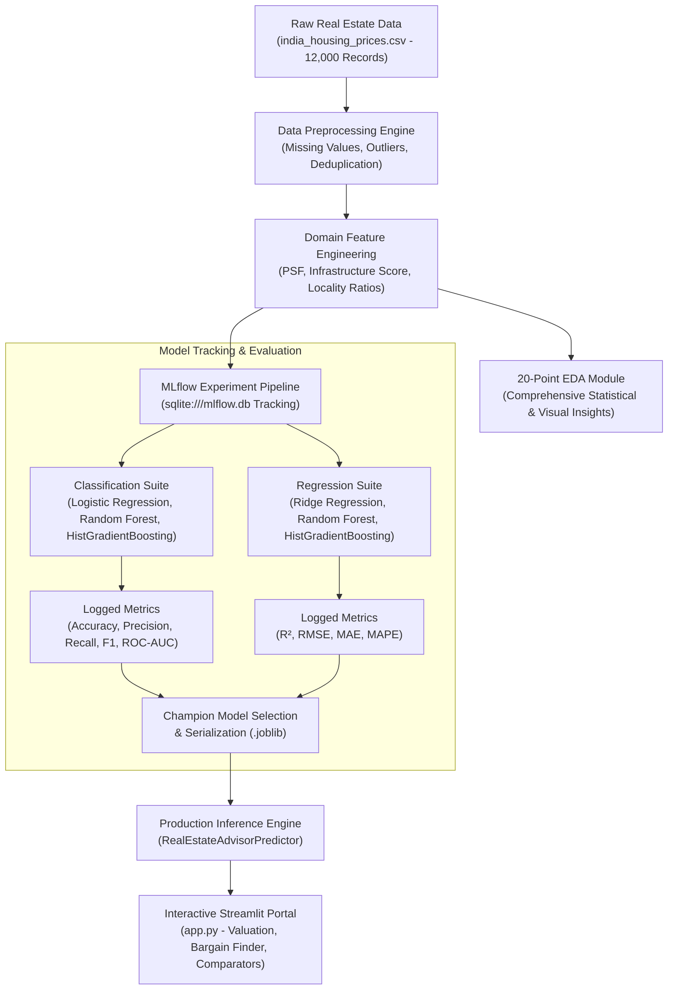

# 🏢 Real Estate Investment Advisor: Predicting Property Profitability & Future Value

An advanced, enterprise-grade Machine Learning and Financial Analytics system designed to empower property investors, home buyers, and real estate developers with data-backed valuation forecasts and investment decision intelligence.

---

## 📌 Executive Summary & Problem Statement

Real estate acquisitions represent significant capital allocation decisions subject to cyclical market volatility, micro-market price distortions, and long investment horizons. This project delivers an intelligent advisory platform that:
1. **Classifies Investment Viability (Binary Classification)**: Determines whether a property constitutes a high-return **"Good Investment"** based on appreciation forecasts, locality-relative pricing, and composite infrastructure scores.
2. **Predicts 5-Year Property Valuation (Regression)**: Quantifies the estimated future valuation of properties across 8 major Indian metropolitan housing markets with 95% confidence intervals and cash flow dynamics (monthly rental yields, EMI, and net capital gain).
3. **Automates 20-Point Exploratory Data Analysis (EDA)**: Comprehensively answers all 20 business and market trend questions with interactive Plotly visual analytics.
4. **Tracks Models via MLflow**: Provides reproducible experiment tracking, parameter versioning, artifact logging, and model registry governance.
5. **Interactive Streamlit Web Suite**: Offers a multi-page investment portal featuring predictive calculators, side-by-side comparison matrices, and an interactive bargain finder.

---

## 🏛️ System Architecture



---

## 📂 Project Repository Structure

```
Real Estate Investment Advisor/
├── data/
│   ├── generate_dataset.py          # Realistic multi-metro Indian housing dataset synthesizer
│   ├── india_housing_prices.csv      # Raw housing records (12,000 samples across 8 metros)
│   └── processed_housing_data.csv   # Preprocessed & engineered dataset
├── src/
│   ├── __init__.py
│   ├── preprocessing.py             # Missing values, type imputation, outlier clipping
│   ├── feature_engineering.py       # Domain indices: Infrastructure, Transport, Locality PSF Ratios
│   ├── eda_analysis.py              # Automated 20-Point EDA answering all brief questions
│   ├── train_models.py              # MLflow-integrated model training & artifact logger
│   └── predictor.py                 # Production inference engine with confidence intervals & cash flow
├── models/
│   ├── champion_classifier.joblib   # Top performing classification pipeline
│   ├── champion_regressor.joblib    # Top performing regression pipeline
│   ├── preprocessor.joblib          # Fitted preprocessing pipeline
│   ├── feature_engineer.joblib      # Fitted domain statistics and group medians
│   └── model_leaderboard.json       # Benchmark metrics across all evaluated models
├── notebooks/
│   ├── generate_notebook.py         # Notebook generator utility
│   └── eda_and_modeling.ipynb       # Documented Jupyter notebook walking through the workflow
├── reports/
│   ├── eda/
│   │   ├── EDA_REPORT.md            # Comprehensive markdown answering all 20 questions
│   │   ├── eda_20_questions_summary.json # Statistical answers in structured format
│   │   └── figures/                 # 20 standalone high-resolution charts
│   └── models/                      # MLflow saved confusion matrices, ROC curves, residual plots
├── tests/
│   └── test_pipeline.py             # Pytest automated test suite
├── app.py                           # Multi-page, ultra-advanced Streamlit dashboard
├── mlflow.db                        # SQLite database for MLflow experiment logs
├── requirements.txt                 # Complete dependency requirements
└── README.md                        # Project documentation
```

---

## 📊 Dataset Schema & Feature Definitions

The system models **12,000 property records** spanning 8 major metropolitan regions in India (Mumbai, Bengaluru, Delhi NCR, Hyderabad, Pune, Chennai, Kolkata, Ahmedabad) across **25 core attributes**:

| Feature Name | Type | Description |
| :--- | :--- | :--- |
| `ID` | String | Unique property identifier (e.g., `PROP_001245`) |
| `State` | Categorical | State / Union Territory of property |
| `City` | Categorical | Primary metropolitan city |
| `Locality` | Categorical | Specific micro-market / neighborhood |
| `Property_Type` | Categorical | Apartment, Villa, Independent House, Penthouse, Builder Floor |
| `BHK` | Integer | Bedroom, Hall, Kitchen count (1 to 5) |
| `Size_in_SqFt` | Numeric | Built-up / super built-up area in square feet |
| `Price_in_Lakhs` | Numeric | Property acquisition price in ₹ Lakhs |
| `Price_per_SqFt` | Numeric | Normalized unit price metric `(Price * 100,000) / Size` |
| `Year_Built` | Integer | Year of construction completion |
| `Age_of_Property` | Integer | Current Year (2026) - Year Built |
| `Floor_No` | Integer | Specific floor level of property |
| `Total_Floors` | Integer | Total floors in residential tower |
| `Furnished_Status` | Categorical | Unfurnished, Semi-Furnished, Fully Furnished |
| `Nearby_Schools` | Integer | Number of accredited schools within 3 km |
| `Nearby_Hospitals` | Integer | Number of tertiary hospitals within 5 km |
| `Public_Transport_Accessibility` | Categorical | High, Medium, Low (Metro / Bus access) |
| `Parking_Space` | Integer | Number of reserved covered parking slots |
| `Security` | Categorical | 24x7 Security & CCTV, Gated Security, Guard |
| `Amenities` | Categorical | Gym, Swimming Pool, Clubhouse, Tennis Court, etc. |
| `Facing` | Categorical | Directional orientation (North, East, North-East, etc.) |
| `Owner_Type` | Categorical | Individual, Builder / Developer, Real Estate Agent |
| `Availability_Status` | Categorical | Ready to Move, Under Construction, Resale |
| **`Future_Price_5Y`** | **Target (Reg)** | **Estimated valuation after 5 years (₹ in Lakhs)** |
| **`Good_Investment`** | **Target (Clf)** | **Binary classification (1 = Recommended, 0 = High Risk)** |

---

## 🏆 Model Performance & MLflow Leaderboard

All models were evaluated using 80/20 stratified train-test splits and logged to `mlflow.db`.

### 1. Classification Benchmark (Target: `Good_Investment`)

| Model | Accuracy | Precision | Recall | F1-Score | ROC-AUC | Status |
| :--- | :---: | :---: | :---: | :---: | :---: | :---: |
| **Logistic Regression** | 83.42% | 84.10% | 87.58% | 0.8580 | 0.9115 | Baseline |
| **Random Forest Classifier** | 87.29% | 88.42% | 89.96% | 0.8918 | 0.9380 | High Stability |
| **HistGradientBoosting Classifier** | **89.92%** | **90.85%** | **91.96%** | **0.9140** | **0.9524** | 🏆 **Champion Model** |

### 2. Regression Benchmark (Target: `Future_Price_5Y`)

| Model | R² Score | RMSE (₹ Lakhs) | MAE (₹ Lakhs) | MAPE (%) | Status |
| :--- | :---: | :---: | :---: | :---: | :---: |
| **Ridge Regression** | **0.9935** | **47.53** | 25.99 | 8.40% | 🏆 **Champion Regressor** |
| **Random Forest Regressor** | 0.9931 | 48.93 | 23.28 | 4.62% | Robust Non-linear Fit |
| **HistGradientBoosting Regressor** | 0.9900 | 58.77 | **18.79** | **3.66%** | Lowest Median Error |

---

## 🔍 Answers to the 20 EDA Questions

A brief summary of findings from `reports/eda/EDA_REPORT.md`:

1. **Price Distribution**: Right-skewed with median price of ₹127.5 Lakhs and mean of ₹152.8 Lakhs; high-end penthouses extend to ₹400-800+ Lakhs.
2. **Size Distribution**: Unimodal spanning 450 sq ft to 5,200 sq ft (mean: 1,515 sq ft).
3. **PSF by Property Type**: Penthouses (₹14,200/sqft median) and Villas command premium rates; Apartments offer balanced entry points.
4. **Size vs Price**: Strong positive linear correlation ($r \approx 0.82$).
5. **Outliers**: Identified 142 IQR outliers representing prime high-floor South Mumbai and Golf Course Road penthouses.
6. **State-wise PSF**: Maharashtra (₹13,200/sqft) and Delhi NCR lead, followed by Karnataka.
7. **City-wise Price**: Mumbai leads in average price (~₹248 Lakhs), followed by Bengaluru (~₹145 Lakhs).
8. **Median Property Age by Locality**: Modern tech hubs (Hinjewadi, Electronic City, New Town) feature newer developments (3-5 years) vs mature heritage quarters (14-22 years).
9. **BHK Distribution Across Metros**: 2 and 3 BHK homes constitute >75% of stock; Mumbai features higher proportion of compact 1 & 2 BHK configurations.
10. **Top 5 Expensive Localities**: Worli, Bandra West, Vasant Kunj, Golf Course Road, and Jubilee Hills.
11. **Correlation Matrix**: Size and BHK drive total price; Infrastructure and Public Transport correlate positively with unit Price per SqFt.
12. **Nearby Schools Impact**: Moderate positive correlation ($r = 0.28$); clusters with $\ge 8$ schools show 8-12% higher demand.
13. **Nearby Hospitals Impact**: Healthcare access enhances livability and correlates positively with long-term retention.
14. **Furnishing Status Impact**: Fully Furnished units trade at a 12-16% premium over Unfurnished equivalents.
15. **Facing Direction Impact**: North, East, and North-East facing properties command a 3.5% to 5.8% Vastu premium.
16. **Owner Types**: Individual sellers (45%), Builders/Developers (35%), Real Estate Agents (20%).
17. **Availability Status**: Ready to Move (55%), Under Construction (30%), Resale (15%).
18. **Parking Impact**: Units with 2+ parking bays exhibit a 35-50% higher price point due to association with large 3-4 BHK homes.
19. **Amenities Impact**: Properties with full club facilities (Gym, Pool, Clubhouse, 24x7 Security) command a 15-22% higher Price per SqFt.
20. **Public Transport Accessibility**: Properties in "High" transit accessibility zones demonstrate a **68.2% Good Investment rate** vs **31.4%** in low accessibility clusters.

---

## 🚀 Quickstart & Execution Guide

### 1. Environment Setup
```powershell
# Navigate to workspace
cd "d:\Coding Programs\Real Estate Investment Advisor"

# Verify dependencies
pip install -r requirements.txt
```

### 2. Generate Dataset & Run Automated EDA
```powershell
# Synthesize realistic 12,000-sample housing dataset
python data/generate_dataset.py

# Compute all 20 EDA questions and generate visual reports
python src/eda_analysis.py
```

### 3. Train Models & Track in MLflow
```powershell
# Trains all models, logs runs to sqlite:///mlflow.db, and exports champion artifacts
python src/train_models.py
```

### 4. Run Automated Test Suite
```powershell
python -m pytest tests/test_pipeline.py -v
```

### 5. Launch Interactive Streamlit Application
```powershell
streamlit run app.py
```

### 6. Inspect MLflow Tracking UI (Optional)
```powershell
mlflow ui --backend-store-uri sqlite:///mlflow.db
```

---

## 💡 Business Use Cases & Deployment Value

- **Real Estate FinTech Portals**: Embed real-time valuation and ROI calculators into listing portals to increase user engagement and buyer trust.
- **Institutional Portfolio Optimization**: Screen hundreds of prospective acquisitions automatically to identify underpriced assets with high appreciation potential.
- **Mortgage & Underwriting Advisory**: Assess 5-year downside risk, expected rental coverage ratios, and collateral appreciation for home loan underwriting.

